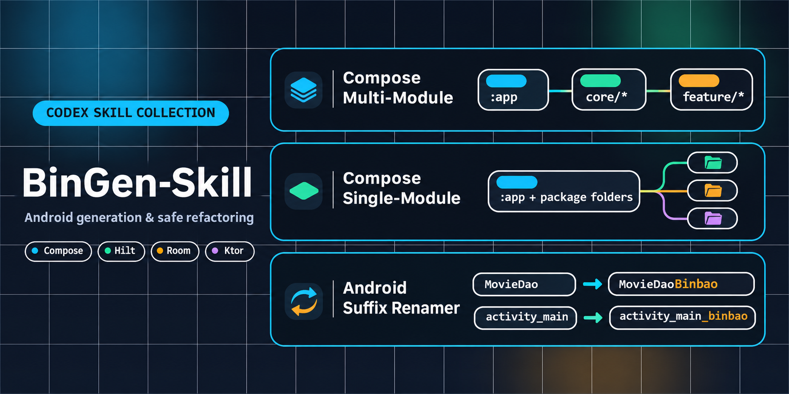

# BinGen-Skill

`BinGen-Skill` is a small Codex skill collection for scaffolding brand-new Android projects with a Compose-first structure.

This repository currently includes two Android app generator skills:

- `skill-gen-app-compose-multi-module`: creates a modular project with `app`, `core/*`, `feature/*`, `resources`, and `build-logic`
- `skill-gen-app-compose-single-module`: creates a single `:app` module project while keeping `app`, `core/*`, and `feature/*` separated by package folders

## Repo Layout

```text
skills/
  skill-gen-app-compose-multi-module/
    SKILL.md
    agents/
    references/
    scripts/
  skill-gen-app-compose-single-module/
    SKILL.md
    agents/
    assets/
    references/
    scripts/
assets/
  readme-banner.png
```

## Which Skill To Use

Use `skill-gen-app-compose-multi-module` when you want:

- a larger project baseline
- clear Gradle module boundaries
- `app / core / feature / resources / build-logic`
- an architecture shaped like a production-ready modular app

Use `skill-gen-app-compose-single-module` when you want:

- a simpler project to start from
- only one Android module, `:app`
- package-based separation inside `app/src/main/java`
- a cleaner onboarding path for small or medium apps

## Install

Install every skill in this repo:

```powershell
npx skills add https://github.com/baothanhbin/BinGen-Skill
```

Install only the multi-module skill:

```powershell
npx skills add https://github.com/baothanhbin/BinGen-Skill --skill "skill-gen-app-compose-multi-module"
```

Install only the single-module skill:

```powershell
npx skills add https://github.com/baothanhbin/BinGen-Skill --skill "skill-gen-app-compose-single-module"
```

Restart Codex after installation so the new skill list is reloaded.

## Manual Install

Copy the desired skill folder into your local Codex skills directory.

Example target folders:

```text
%USERPROFILE%\.codex\skills\skill-gen-app-compose-multi-module
%USERPROFILE%\.codex\skills\skill-gen-app-compose-single-module
```

Source folders in this repo:

```text
skills/skill-gen-app-compose-multi-module
skills/skill-gen-app-compose-single-module
```

## Usage

Basic multi-module trigger:

```text
Use $skill-gen-app-compose-multi-module to scaffold a new Android project with a Compose multi-module architecture.
```

Basic single-module trigger:

```text
Use $skill-gen-app-compose-single-module to scaffold a new Android project with a Compose single-module architecture.
```

Recommended multi-module prompt:

```text
Use $skill-gen-app-compose-multi-module to scaffold a new Android project.

Project:
- App name: PlantCareAI
- Package: com.baothanhbin.plantcareai
- Slug: plantcareai

Features:
- home
- login
- diagnosis
- reminders
- profile

Screens:
- Splash
- Login
- Home
- DiagnosisHistory
- DiagnosisDetail
- ReminderList
- ReminderDetail
- Profile

Data layer:
- Ktor for remote APIs
- Room for local entities
- Proto DataStore for auth/session

Background work:
- WorkManager enabled
- SyncPlantsWorker
- SyncRemindersWorker

Scaffold the project in the current working directory.
```

Recommended single-module prompt:

```text
Use $skill-gen-app-compose-single-module to scaffold a new Android project.

Project:
- App name: ListeningStarter
- Package: com.example.listeningstarter

Features:
- home
- library
- settings

Requirements:
- Compose-first UI
- Hilt setup
- Room enabled
- Proto DataStore enabled
- starter navigation and app shell

Scaffold the project in the current working directory.
```

If you want a shorter prompt, provide at least:

- project name
- package name
- starter features
- whether you want `single-module` or `multi-module`
- whether to enable Hilt, Room, DataStore, Ktor, and WorkManager

## What Each Skill Contains

Each skill folder includes:

- `SKILL.md`: behavior, workflow, execution rules, and output expectations
- `references/`: architecture notes, code patterns, and validation checklists
- `scripts/scaffold_project.py`: the project scaffold generator
- `agents/openai.yaml`: skill agent configuration where applicable

## Notes

- The multi-module skill is more opinionated and targets a stronger production-style baseline.
- The single-module skill keeps structure simpler while preserving feature and layer boundaries.
- Both skills are designed to generate real project files, not just planning text.

## Skill Docs

- [Multi-module skill](skills/skill-gen-app-compose-multi-module/SKILL.md)
- [Single-module skill](skills/skill-gen-app-compose-single-module/SKILL.md)
